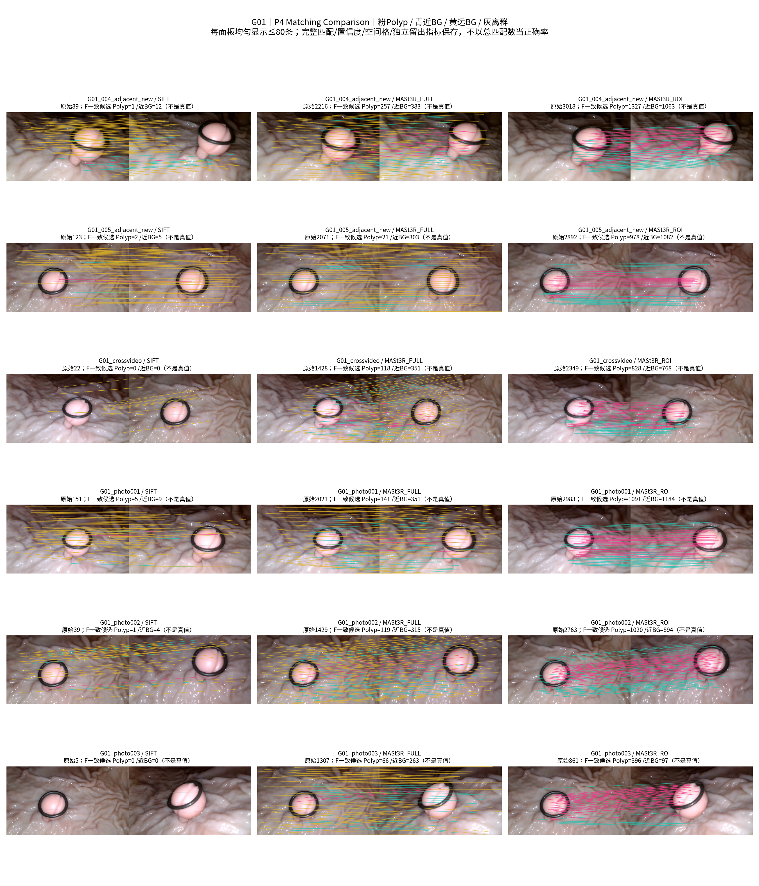
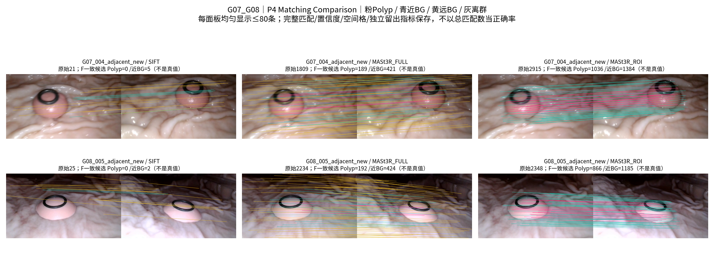
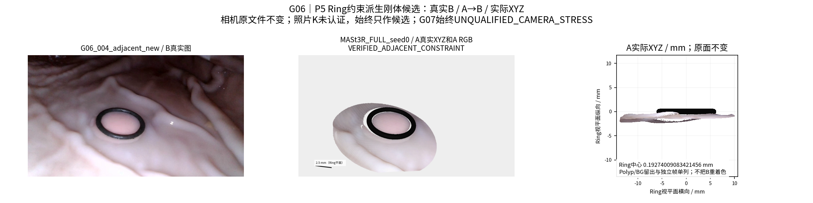
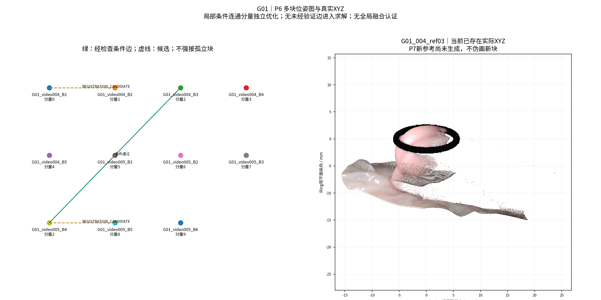
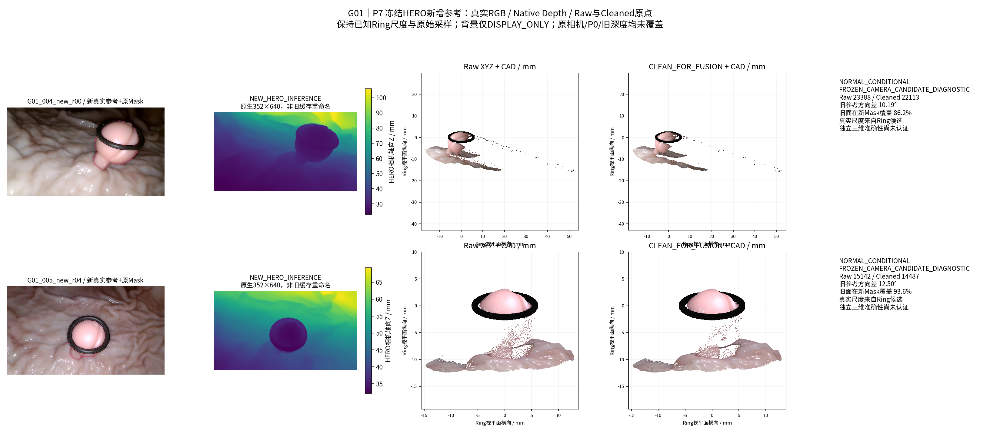
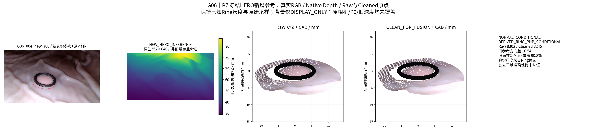
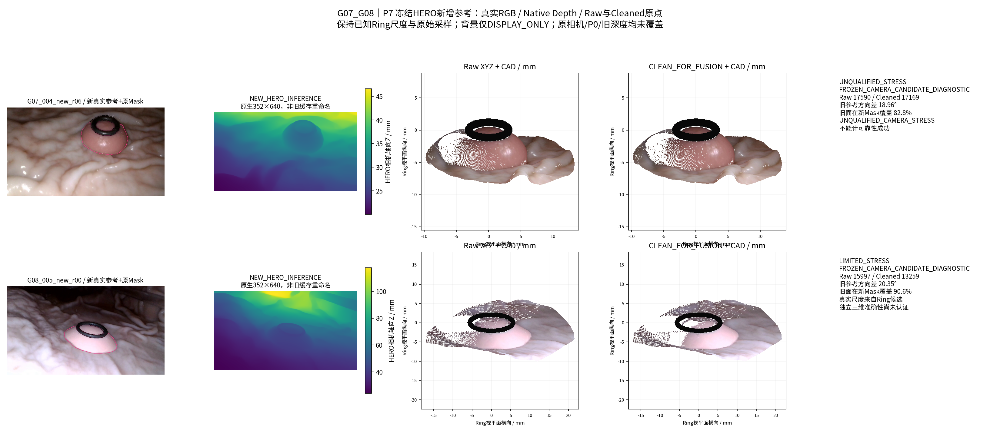

# 视角分区与MASt3R辅助选择性聚合

状态：RUNNING / EXPERIMENTAL。四批次连续授权；GT模式NONE。仅新增派生结果，旧P0/相机/HERO权重/Dxy冻结。物理精度尚未认证。

中文摘要：本轮按真实相机与息肉中心代理方向组织视角块，采用既有绝对密度T2与细小结构保护生成Cleaned，使用官方MASt3R匹配和Ring约束派生配准，再对新方向运行冻结HERO，最后进行方向负责制聚合。相机未筛选场景与照片保持候选身份，成功与失败均保留。报告在各批次以同一文件更新，不将数值输出、展示、融合验收和物理测量混为一谈。

## Batch A — Cleaned与方向分区

P0–P3已实算：4独立物理组、5视频、9归档P0；62个冻结视频相机候选与3张位姿未知照片；21个方向块。G07为UNQUALIFIED_CAMERA_STRESS。下表方向仅在各视频独立Ring局部坐标内成立，不等同位姿真值；候选坏位姿可能产生虚假的方向跨度。

|组|Raw点|Cleaned点|方向块|新HERO计划|
|---|---|---|---|---|
|G01|98843|92933|11|G01_video004_004_00, G01_video005_v005_00229|
|G06|9282|9256|3|G06_video004_key00_raw00107|
|G07|19784|19386|3|G07_video004_key06_raw00520|
|G08|19631|17381|4|G08_video005_key00_raw00120|

G01 T2为004=49.21594809052892、005=58.17189372286792点/mm²。其他组三组统一实验性迁移49.21594809052892，不按组调参。保护可能细柄代理、Ring邻近与原完整小分量；不移动XYZ、不补孔。Cleaned始终实验候选，损伤与孔洞统计完整保留，不采用上轮被拒绝的角度法。

方向用(c−息肉中心代理)/距离；中心由已清理源点上部60%源像素的中位XYZ确定，无GT。Complete-link 10°，邻接18°和冻结参考投影Mask支持≥35%。Core/Transition/Holdout身份已在正式匹配及图像误差评价前冻结；孤立块无独立留出时明确无验证。三照片没有公制位姿，不进入精确方向聚类。

预选5份新参考是与旧P0方向差最大的非留出真实帧，差约10.19°/12.50°/16.54°/18.96°/20.35°；这些方向差依赖冻结候选相机，**不证明新真实表面存在**。G01_005、G06/G08新目标仍含MODEL_PREDICTED相机，Batch B必须检查派生PnP；不把它们升级为已认证位姿。G07全部压力测试，仍实际尝试新增参考。

已核实本地官方MASt3R权重SHA与HERO原权重SHA，GPU6GB，磁盘约6GB余量；模型不复制、不下载、不训练。官方实现与许可依据：[MASt3R](https://github.com/naver/mast3r)、[许可](https://github.com/naver/mast3r/blob/main/LICENSE)；代码/权重只读，匹配点图不充作公制P0。

每个P0/P1/P2/P3阶段另有3张真实复合图，覆盖四组，见图库。下一批固定使用这些分区和帧身份进行MASt3R全图/ROI及历史对照，不按最终RGB误差选配对。

## Batch B — MASt3R与邻接图

正式完成9配对×SIFT/MASt3R全图/MASt3R ROI=27臂，其中18次MASt3R新前向，全部返回匹配。官方本地权重与源码只读，未用神经点图生成几何。

|配对|方法|原匹配|Polyp F一致候选|近BG F一致候选|
|---|---|---|---|---|
|G01_004_adjacent_new|SIFT|89|1|12|
|G01_005_adjacent_new|SIFT|123|2|5|
|G06_004_adjacent_new|SIFT|23|0|3|
|G07_004_adjacent_new|SIFT|21|0|5|
|G08_005_adjacent_new|SIFT|25|0|2|
|G01_crossvideo|SIFT|22|0|0|
|G01_photo001|SIFT|151|5|9|
|G01_photo002|SIFT|39|1|4|
|G01_photo003|SIFT|5|0|0|
|G01_004_adjacent_new|MASt3R_FULL|2216|257|383|
|G01_004_adjacent_new|MASt3R_ROI|3018|1327|1063|
|G01_005_adjacent_new|MASt3R_FULL|2071|21|303|
|G01_005_adjacent_new|MASt3R_ROI|2892|978|1082|
|G06_004_adjacent_new|MASt3R_FULL|2226|92|320|
|G06_004_adjacent_new|MASt3R_ROI|2689|750|1347|
|G07_004_adjacent_new|MASt3R_FULL|1809|189|421|
|G07_004_adjacent_new|MASt3R_ROI|2915|1036|1384|
|G08_005_adjacent_new|MASt3R_FULL|2234|192|424|
|G08_005_adjacent_new|MASt3R_ROI|2348|866|1185|
|G01_crossvideo|MASt3R_FULL|1428|118|351|
|G01_crossvideo|MASt3R_ROI|2349|828|768|
|G01_photo001|MASt3R_FULL|2021|141|351|
|G01_photo001|MASt3R_ROI|2983|1091|1184|
|G01_photo002|MASt3R_FULL|1429|119|315|
|G01_photo002|MASt3R_ROI|2763|1020|894|
|G01_photo003|MASt3R_FULL|1307|66|263|
|G01_photo003|MASt3R_ROI|861|396|97|

F一致只是候选，不是正确匹配标签；密集近邻输出存在相关采样。所有原始点对、描述子置信度、Ring/反光、类别、F内/离群和空间格均保存。PnP只用Cleaned实际Polyp XYZ和历史质量背景原点，源像素最近≤2px；不使用MASt3R点图。每区域4×3格均衡，远BG限额，2个固定种子，Ring中心/法向先验与Ring Mask的有限60次局部优化。目标B RGB仅在预测生成后比较。

|配对|选定候选|状态|独立真实帧状态|
|---|---|---|---|
|G01_004_adjacent_new|MASt3R_ROI_seed0|REGISTRATION_CANDIDATE|SUPPORTED_CONDITIONALLY|
|G01_005_adjacent_new|MASt3R_FULL_seed0|REGISTRATION_CANDIDATE|SUPPORTED_CONDITIONALLY|
|G06_004_adjacent_new|MASt3R_FULL_seed0|VERIFIED_ADJACENT_CONSTRAINT|SUPPORTED_CONDITIONALLY|
|G07_004_adjacent_new|MASt3R_FULL_seed0|REGISTRATION_CANDIDATE|SUPPORTED_CONDITIONALLY|
|G08_005_adjacent_new|MASt3R_FULL_seed0|REGISTRATION_CANDIDATE|NOT_EVALUABLE_NO_FROZEN_HELD_CAMERA|
|G01_crossvideo|MASt3R_FULL_seed0|VERIFIED_ADJACENT_CONSTRAINT|SUPPORTED_CONDITIONALLY|
|G01_photo001|MASt3R_ROI_seed0|REGISTRATION_CANDIDATE|NOT_EVALUABLE_NO_FROZEN_HELD_CAMERA|
|G01_photo002|SIFT_seed0|REGISTRATION_CANDIDATE|NOT_EVALUABLE_NO_FROZEN_HELD_CAMERA|
|G01_photo003|MASt3R_FULL_seed0|REGISTRATION_CANDIDATE|NOT_EVALUABLE_NO_FROZEN_HELD_CAMERA|

图为21节点、19个分量、2条条件通过边；初次全图Open3D因不连通拒绝，已保留日志并改为逐真实连通分量优化。没有添加边解决连通性。G01跨视频仅得到一条**条件约束**，尚未通过完整几何/双向融合验收；三照片K仍未认证，不能记为三维新增。G07不入正常成功率。后续将实际运行5份新HERO参考，只有相机条件检查通过者采用派生位姿，其余保留冻结候选并标记诊断身份。

同图像历史LightGlue/RoMa缓存另作只读对照：8/18方法-配对缓存可用，其余明确缺失。G01跨视频的Polyp F一致候选为LightGlue0、RoMa194、MASt3R全图118、ROI828；因此全图MASt3R并未普遍优于RoMa，ROI增加也仍非真实性标签。新帧对没有相同旧缓存，使用实际新SIFT作为成熟方法对照，不回填旧结果。见[历史匹配表](metrics/historical_matching_baselines.csv)。

## Batch C — 新HERO参考与真实XYZ

四组实际运行5次冻结HERO新参考推理，全部生成原生深度与Raw XYZ。首次背景包装缺少lru_cache、Image依赖，深度与原点已保存；修复后仅恢复后处理，**没有再次推理**，原生深度SHA逐份未变，错误记录保留。

|新参考|Raw点|Cleaned点|相机身份|
|---|---|---|---|
|G01_004_new_r00|23388|22113|FROZEN_CAMERA_CANDIDATE_DIAGNOSTIC|
|G01_005_new_r04|15142|14487|FROZEN_CAMERA_CANDIDATE_DIAGNOSTIC|
|G06_004_new_r00|8302|8245|DERIVED_RING_PNP_CONDITIONAL|
|G07_004_new_r06|17590|17169|FROZEN_CAMERA_CANDIDATE_DIAGNOSTIC|
|G08_005_new_r00|15997|13259|FROZEN_CAMERA_CANDIDATE_DIAGNOSTIC|

新增总参考5：G01两视频各1，G06/G07/G08各1；旧参考仍9，合计14，不能把同组两视频计独立病例。G06使用条件通过的派生新相机，其他使用冻结候选；G07只作不合格压力测试。三照片经过实际MASt3R/候选PnP检查，但K/部署位姿未认证，不伪造公制深度。

HERO调用逐字AST复用load_official；backprojection/mesh逐字复用原unproject/depth_mesh。遵循原gallery流程：原生352×640深度仅作既有双线性尺寸适配到640×360，再在对应原像素执行既有反投影；本轮没有第二套深度/相机/mesher。原生深度完整保留；其后不插值或平滑点云。源RGB、Mask、K、c2w、三源视角、原点UV/ID、清理标记、单位和SHA都在清单中。G01 video004仅有历史缓存索引身份，原视频精确顺序帧号未独立认证，保留Unknown而不猜。

新方向差依赖相机候选，不能把五次推理当五次几何正确。新XYZ投到冻结留出帧的Raw/Cleaned独立及共同分母见[验证](metrics/new_reference_validation.csv)，缺留出相机的保留NOT_EVALUABLE。后续实际进入F1多块与F2负责制聚合。
