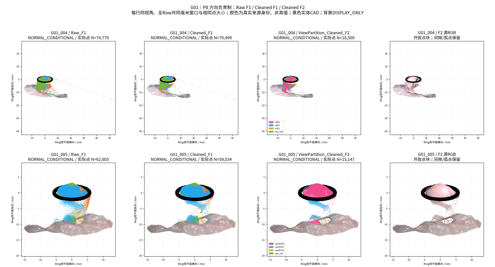
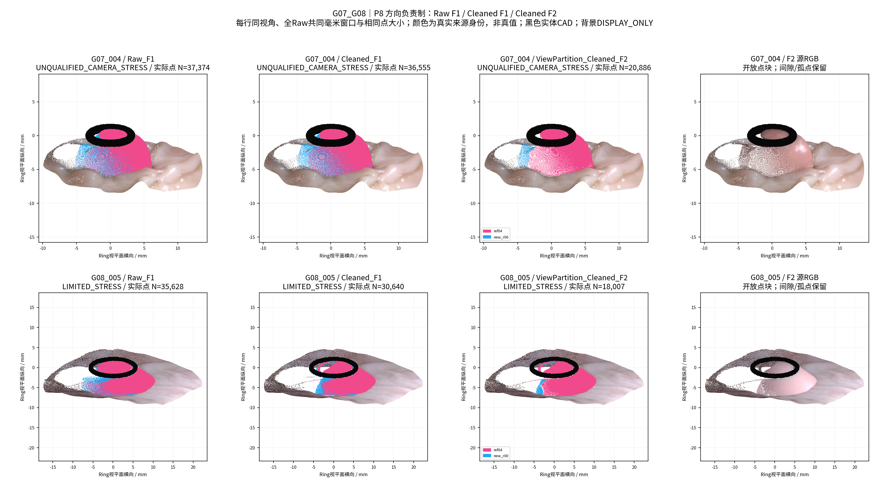
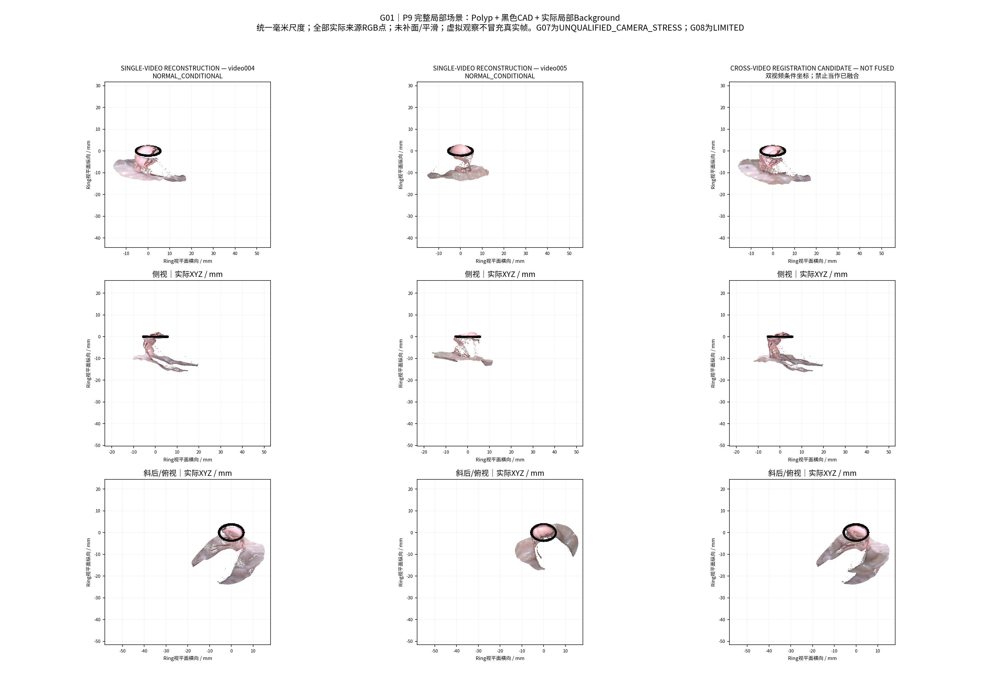
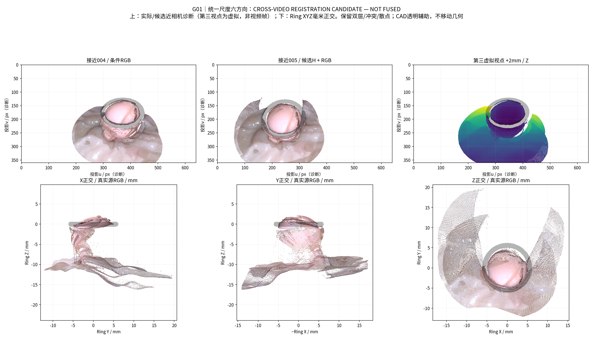

# 视角分区与MASt3R辅助选择性聚合

状态：COMPLETED / EXPERIMENTAL，等待人工验收。四批次连续授权；GT模式NONE。仅新增派生结果，旧P0/相机/HERO权重/Dxy冻结。物理精度尚未认证。

中文摘要：四组实际完成18次官方MASt3R前向、5次冻结HERO新参考推理，以及方向负责制Raw/Cleaned F1/F2聚合。新参考产生80419个Raw XYZ，5视频分别接纳1919/308/185/1500/626个新来源点。005真实非自投影覆盖提高5.21个百分点，G06提高0.42个百分点，但共同支持误差未普遍改善；004有明显恶化和留出身份限制，新增原面仍碎裂。跨视频双向轴向冲突约66%/70%，联合场景明确NOT FUSED。工程实现完成，可信新增解剖面积和绝对精度尚不能认证，三照片未伪造公制XYZ。GT、旧P0、正式相机、HERO权重和Dxy均保持冻结。

## Batch A — Cleaned与方向分区

P0–P3已实算：4独立物理组、5视频、9归档P0；62个冻结视频相机候选与3张位姿未知照片；21个方向块。G07为UNQUALIFIED_CAMERA_STRESS。下表方向仅在各视频独立Ring局部坐标内成立，不等同位姿真值；候选坏位姿可能产生虚假的方向跨度。

|组|Raw点|Cleaned点|方向块|新HERO计划|
|---|---|---|---|---|
|G01|98843|92933|11|G01_video004_004_00, G01_video005_v005_00229|
|G06|9282|9256|3|G06_video004_key00_raw00107|
|G07|19784|19386|3|G07_video004_key06_raw00520|
|G08|19631|17381|4|G08_video005_key00_raw00120|

G01 T2为004=49.21594809052892、005=58.17189372286792点/mm²。其他组三组统一实验性迁移49.21594809052892，不按组调参。保护可能细柄代理、Ring邻近与原完整小分量；不移动XYZ、不补孔。Cleaned始终实验候选，损伤与孔洞统计完整保留，不采用上轮被拒绝的角度法。

方向用(c−息肉中心代理)/距离；中心由已清理源点上部60%源像素的中位XYZ确定，无GT。Complete-link 10°，邻接18°和冻结参考投影Mask支持≥35%。Core/Transition/Holdout身份已在正式匹配及图像误差评价前冻结；孤立块无独立留出时明确无验证。三照片没有公制位姿，不进入精确方向聚类。

预选5份新参考是与旧P0方向差最大的非留出真实帧，差约10.19°/12.50°/16.54°/18.96°/20.35°；这些方向差依赖冻结候选相机，**不证明新真实表面存在**。G01_005、G06/G08新目标仍含MODEL_PREDICTED相机，Batch B必须检查派生PnP；不把它们升级为已认证位姿。G07全部压力测试，仍实际尝试新增参考。

已核实本地官方MASt3R权重SHA与HERO原权重SHA，GPU6GB，磁盘约6GB余量；模型不复制、不下载、不训练。官方实现与许可依据：[MASt3R](https://github.com/naver/mast3r)、[许可](https://github.com/naver/mast3r/blob/main/LICENSE)；代码/权重只读，匹配点图不充作公制P0。

每个P0/P1/P2/P3阶段另有3张真实复合图，覆盖四组，见图库。下一批固定使用这些分区和帧身份进行MASt3R全图/ROI及历史对照，不按最终RGB误差选配对。

## Batch B — MASt3R与邻接图

正式完成9配对×SIFT/MASt3R全图/MASt3R ROI=27臂，其中18次MASt3R新前向，全部返回匹配。官方本地权重与源码只读，未用神经点图生成几何。

|配对|方法|原匹配|Polyp F一致候选|近BG F一致候选|
|---|---|---|---|---|
|G01_004_adjacent_new|SIFT|89|1|12|
|G01_005_adjacent_new|SIFT|123|2|5|
|G06_004_adjacent_new|SIFT|23|0|3|
|G07_004_adjacent_new|SIFT|21|0|5|
|G08_005_adjacent_new|SIFT|25|0|2|
|G01_crossvideo|SIFT|22|0|0|
|G01_photo001|SIFT|151|5|9|
|G01_photo002|SIFT|39|1|4|
|G01_photo003|SIFT|5|0|0|
|G01_004_adjacent_new|MASt3R_FULL|2216|257|383|
|G01_004_adjacent_new|MASt3R_ROI|3018|1327|1063|
|G01_005_adjacent_new|MASt3R_FULL|2071|21|303|
|G01_005_adjacent_new|MASt3R_ROI|2892|978|1082|
|G06_004_adjacent_new|MASt3R_FULL|2226|92|320|
|G06_004_adjacent_new|MASt3R_ROI|2689|750|1347|
|G07_004_adjacent_new|MASt3R_FULL|1809|189|421|
|G07_004_adjacent_new|MASt3R_ROI|2915|1036|1384|
|G08_005_adjacent_new|MASt3R_FULL|2234|192|424|
|G08_005_adjacent_new|MASt3R_ROI|2348|866|1185|
|G01_crossvideo|MASt3R_FULL|1428|118|351|
|G01_crossvideo|MASt3R_ROI|2349|828|768|
|G01_photo001|MASt3R_FULL|2021|141|351|
|G01_photo001|MASt3R_ROI|2983|1091|1184|
|G01_photo002|MASt3R_FULL|1429|119|315|
|G01_photo002|MASt3R_ROI|2763|1020|894|
|G01_photo003|MASt3R_FULL|1307|66|263|
|G01_photo003|MASt3R_ROI|861|396|97|

F一致只是候选，不是正确匹配标签；密集近邻输出存在相关采样。所有原始点对、描述子置信度、Ring/反光、类别、F内/离群和空间格均保存。PnP只用Cleaned实际Polyp XYZ和历史质量背景原点，源像素最近≤2px；不使用MASt3R点图。每区域4×3格均衡，远BG限额，2个固定种子，Ring中心/法向先验与Ring Mask的有限60次局部优化。目标B RGB仅在预测生成后比较。

|配对|选定候选|状态|独立真实帧状态|
|---|---|---|---|
|G01_004_adjacent_new|MASt3R_ROI_seed0|REGISTRATION_CANDIDATE|SUPPORTED_CONDITIONALLY|
|G01_005_adjacent_new|MASt3R_FULL_seed0|REGISTRATION_CANDIDATE|SUPPORTED_CONDITIONALLY|
|G06_004_adjacent_new|MASt3R_FULL_seed0|VERIFIED_ADJACENT_CONSTRAINT|SUPPORTED_CONDITIONALLY|
|G07_004_adjacent_new|MASt3R_FULL_seed0|REGISTRATION_CANDIDATE|SUPPORTED_CONDITIONALLY|
|G08_005_adjacent_new|MASt3R_FULL_seed0|REGISTRATION_CANDIDATE|NOT_EVALUABLE_NO_FROZEN_HELD_CAMERA|
|G01_crossvideo|MASt3R_FULL_seed0|VERIFIED_ADJACENT_CONSTRAINT|SUPPORTED_CONDITIONALLY|
|G01_photo001|MASt3R_ROI_seed0|REGISTRATION_CANDIDATE|NOT_EVALUABLE_NO_FROZEN_HELD_CAMERA|
|G01_photo002|SIFT_seed0|REGISTRATION_CANDIDATE|NOT_EVALUABLE_NO_FROZEN_HELD_CAMERA|
|G01_photo003|MASt3R_FULL_seed0|REGISTRATION_CANDIDATE|NOT_EVALUABLE_NO_FROZEN_HELD_CAMERA|

图为21节点、19个分量、2条条件通过边；初次全图Open3D因不连通拒绝，已保留日志并改为逐真实连通分量优化。没有添加边解决连通性。G01跨视频仅得到一条**条件约束**，尚未通过完整几何/双向融合验收；三照片K仍未认证，不能记为三维新增。G07不入正常成功率。后续将实际运行5份新HERO参考，只有相机条件检查通过者采用派生位姿，其余保留冻结候选并标记诊断身份。

同图像历史LightGlue/RoMa缓存另作只读对照：8/18方法-配对缓存可用，其余明确缺失。G01跨视频的Polyp F一致候选为LightGlue0、RoMa194、MASt3R全图118、ROI828；因此全图MASt3R并未普遍优于RoMa，ROI增加也仍非真实性标签。新帧对没有相同旧缓存，使用实际新SIFT作为成熟方法对照，不回填旧结果。见[历史匹配表](metrics/historical_matching_baselines.csv)。

## Batch C — 新HERO参考与真实XYZ

四组实际运行5次冻结HERO新参考推理，全部生成原生深度与Raw XYZ。首次背景包装缺少lru_cache、Image依赖，深度与原点已保存；修复后仅恢复后处理，**没有再次推理**，原生深度SHA逐份未变，错误记录保留。

|新参考|Raw点|Cleaned点|相机身份|
|---|---|---|---|
|G01_004_new_r00|23388|22113|FROZEN_CAMERA_CANDIDATE_DIAGNOSTIC|
|G01_005_new_r04|15142|14487|FROZEN_CAMERA_CANDIDATE_DIAGNOSTIC|
|G06_004_new_r00|8302|8245|DERIVED_RING_PNP_CONDITIONAL|
|G07_004_new_r06|17590|17169|FROZEN_CAMERA_CANDIDATE_DIAGNOSTIC|
|G08_005_new_r00|15997|13259|FROZEN_CAMERA_CANDIDATE_DIAGNOSTIC|

新增总参考5：G01两视频各1，G06/G07/G08各1；旧参考仍9，合计14，不能把同组两视频计独立病例。G06使用条件通过的派生新相机，其他使用冻结候选；G07只作不合格压力测试。三照片经过实际MASt3R/候选PnP检查，但K/部署位姿未认证，不伪造公制深度。

HERO调用逐字AST复用load_official；backprojection/mesh逐字复用原unproject/depth_mesh。遵循原gallery流程：原生352×640深度仅作既有双线性尺寸适配到640×360，再在对应原像素执行既有反投影；本轮没有第二套深度/相机/mesher。原生深度完整保留；其后不插值或平滑点云。源RGB、Mask、K、c2w、三源视角、原点UV/ID、清理标记、单位和SHA都在清单中。G01 video004仅有历史缓存索引身份，原视频精确顺序帧号未独立认证，保留Unknown而不猜。

新方向差依赖相机候选，不能把五次推理当五次几何正确。新XYZ投到冻结留出帧的Raw/Cleaned独立及共同分母见[验证](metrics/new_reference_validation.csv)，缺留出相机的保留NOT_EVALUABLE。后续实际进入F1多块与F2负责制聚合。

## Batch D — 来源负责制聚合与最终验证

P8/P9已实算并完成本轮：4个独立物理组、5段视频、14份参考（旧9＋新5）；主输入为CLEAN_FOR_FUSION。全部输出保留原始来源XYZ/UV/点ID/原三角面，**没有补面、焊接或移动反投影后的点**。F1是来源块叠加，F2是条件性来源选择，F3未实施。照片3/3仍只有图像与候选关系，未生成公制XYZ。GT模式NONE。

### 冻结规则与真正实现

负责者评分是相机质量×(0.35方向余弦＋0.25法向可靠比例＋0.20原面连续性＋0.10非留出邻帧Mask支持＋0.10保留原面积比例)。方向块候选限18°或同块。实际实现由方向块负责者形成每视频的来源优先序，再用真实相机反向投影逐点分类；**尚不是逐个三维点的全局方向分区优化**。原主来源全部保留，后续只接纳NOVEL候选的原像素8邻接区域≥3点、原面法向可靠比例≥0.5、邻帧Mask支持≥0.65，并只保留有该支持的原点。不是按3D最近距离一票否决新点，也没有平均错层。

EXPLAINED/NOVEL_CANDIDATE/OCCLUDED/GEOMETRIC_CONFLICT/UNKNOWN均逐点保存。反投影轴向容差max(0.5mm,3个像素物理足迹)为诊断判据，不是准确度保证。法向来自原始有效面，≥3邻面且一致性≥0.85；未重新引入被拒绝的掠射角清理。参数及来源顺序分别见[规则](config/aggregation_rules.json)、[先行冻结](provenance/P8_RULES_AND_SOURCE_FROZEN.json)、[负责者](metrics/surface_ownership.csv)。原rules.json未改；分阶段新增参数独立存放。

|视频|相机条件|参考数|初始主来源|F2点|其他来源接纳点|其中新HERO点|接纳面积暴露代理mm²|接纳源区域|最大区域点|活跃法向格/24|
|---|---|---|---|---|---|---|---|---|---|---|
|G01_004|NORMAL_CONDITIONAL|4|G01_004_ref08|18500|5555|1919|53.060|41|2247|11→13|
|G01_005|NORMAL_CONDITIONAL|4|G01_005_raw00459|15147|3182|308|30.967|47|1662|10→12|
|G06_004|NORMAL_CONDITIONAL|2|G06_004_ref04|9441|185|185|0.949|9|97|8→8|
|G07_004|UNQUALIFIED_STRESS|2|G07_004_ref04|20886|1500|1500|11.659|5|1390|10→10|
|G08_005|LIMITED_STRESS|2|G08_005_ref04|18007|626|626|7.948|11|336|5→6|

所有“接纳”仅表示冻结规则下的有来源候选，不是真实解剖标签。面积代理是原面分摊到点后的暴露量，会包含重复与局部非完整面；**不是去重后的可信新增表面积**。法向24格按当前暴露总量2%定义，分母会变化，不等于真实可见面覆盖率。五个场景都保留初始主来源100%，但其他来源的细柄代理可能被判为重复/冲突而不进入F2，原点仍在F1和逐源NPZ。

### 结构、清理与碎片反例

|视频|Raw已解释→Clean后接纳点|补充点无完整原面引用|新参考完整原面分量|新参考完整原面面积mm²|新参考最大原面分量mm²|新参考细柄代理F2/Cleaned|
|---|---|---|---|---|---|---|
|G01_004|719|306|70|13.424|4.226|55/2441|
|G01_005|92|439|26|1.204|0.741|46/449|
|G06_004|0|85|22|0.247|0.025|56/543|
|G07_004|206|58|17|10.248|8.710|3/543|
|G08_005|340|100|16|6.363|4.260|4/583|

清理造成的空缺可以被另一个来源标为NOVEL；004出现719点、005出现92点，不能将这些点都解释为新观察方向。新参考的完整原面分量为70/26/22/17/16，且有只剩离散点而没有完整原面的接纳点，说明**连续性问题未解决**。细柄是源像素启发式保护代理，不是人工或GT确认的解剖真值；Cleaned保护层完整保留，F2并未保证所有来源保护点都显示。不能宣称真实细柄已认证无损。详见[结构审计](metrics/F2_source_structure_audit.csv)。

### 真实帧分母与历史强对照

图像评价为完整B Polyp Mask分母、实际点中心z-buffer，CAD遮挡；A颜色来自A源像素，B只参与评价。Full Scene背景单独DISPLAY_ONLY，不混入Polyp指标。表中为帧均值；帧/ROI不当作独立病例，逐帧像素分母和共同支持数见[全部评价](metrics/scene_evaluation.csv)。

|视频|方法|帧|平均覆盖|RGB MAE/255|覆盖/目标像素暴露|与Single共同支持MAE|
|---|---|---|---|---|---|---|
|G01_004|Single_Cleaned|2|85.33%|11.906|23112/27039|11.906→11.906|
|G01_004|Raw_F1|2|97.25%|38.934|26293/27039|11.906→40.664|
|G01_004|Cleaned_F1|2|94.45%|38.924|25542/27039|11.906→39.874|
|G01_004|Raw_F2|2|93.36%|17.268|25279/27039|11.906→17.642|
|G01_004|ViewPartition_Cleaned_F2|2|90.89%|17.192|24610/27039|11.906→16.878|
|G01_004|Historical_Primary_Aggregation|2|93.73%|12.935|25376/27039|11.906→13.681|
|G01_004|Historical_B|2|97.24%|27.129|26290/27039|11.906→28.214|
|G01_004|Historical_C|2|97.16%|27.169|26269/27039|11.905→28.232|
|G01_005|Single_Cleaned|5|73.92%|16.981|54509/74751|16.981→16.981|
|G01_005|Raw_F1|5|96.17%|22.999|71891/74751|16.981→24.392|
|G01_005|Cleaned_F1|5|92.27%|23.829|69044/74751|16.981→24.410|
|G01_005|Raw_F2|5|82.81%|16.357|61252/74751|16.981→17.046|
|G01_005|ViewPartition_Cleaned_F2|5|79.13%|16.706|58586/74751|16.981→17.025|
|G01_005|Historical_Primary_Aggregation|5|84.01%|20.892|62077/74751|17.239→20.675|
|G01_005|Historical_B|5|95.88%|23.781|71674/74751|16.981→25.149|
|G01_005|Historical_C|5|89.06%|23.375|66589/74751|17.178→24.861|
|G06_004|Single_Cleaned|2|76.51%|21.948|16105/22661|21.948→21.948|
|G06_004|Raw_F1|2|87.34%|22.046|19083/22661|21.948→22.262|
|G06_004|Cleaned_F1|2|87.34%|22.043|19083/22661|21.948→22.258|
|G06_004|Raw_F2|2|76.93%|21.970|16182/22661|21.948→21.949|
|G06_004|ViewPartition_Cleaned_F2|2|76.93%|21.970|16182/22661|21.948→21.949|
|G07_004|Single_Cleaned|2|89.73%|20.409|32736/36258|20.409→20.409|
|G07_004|Raw_F1|2|97.40%|18.163|35328/36258|20.409→20.619|
|G07_004|Cleaned_F1|2|96.17%|18.123|34874/36258|20.409→20.509|
|G07_004|Raw_F2|2|94.40%|19.150|34339/36258|20.409→20.595|
|G07_004|ViewPartition_Cleaned_F2|2|93.51%|19.027|33998/36258|20.409→20.477|
|G08_005|Single_Cleaned|1|86.60%|15.168|15638/18057|15.168→15.168|
|G08_005|Raw_F1|1|98.80%|14.782|17840/18057|15.168→14.957|
|G08_005|Cleaned_F1|1|89.83%|15.081|16220/18057|15.168→14.986|
|G08_005|Raw_F2|1|97.28%|15.033|17566/18057|15.168→15.141|
|G08_005|ViewPartition_Cleaned_F2|1|88.66%|15.242|16010/18057|15.168→15.159|

历史B/C及上轮主体优先结果只读，用同一本轮点中心投影核复算；其输入仅历史参考，本轮含新增参考，不能把全部变化归因于聚合规则。B/C并非其历史Mesh光栅化协议，本表是统一点中心对照。Raw F1/F2和Cleaned F1/F2完整保留，未只展示主方法。T2输入对照及损伤见[清理表](metrics/cleaned_input_audit.csv)，Raw/T2/Cleaned图在P1。

**留出身份复核纠正**：004的两个A阶段HOLDOUT恰为旧ref08/ref13源图，G07一个HOLDOUT为旧ref04源图。这些不能算整条流程的独立验证。只把“未用于新增HERO/新增匹配”的局部身份冻结并不够；已附加独立的source-image SHA审计，原角色和所有数值均保留，未重选更好帧。G08没有预先冻结的独立HOLDOUT，只作既有目标诊断。

|视频|方法|非自投影预冻结帧数|覆盖%|独立支持MAE|共同支持MAE|
|---|---|---|---|---|---|
|G01_004|Single_Cleaned|0|NOT_EVALUABLE|NOT_EVALUABLE|NOT_EVALUABLE→NOT_EVALUABLE|
|G01_004|ViewPartition_Cleaned_F2|0|NOT_EVALUABLE|NOT_EVALUABLE|NOT_EVALUABLE→NOT_EVALUABLE|
|G01_005|Single_Cleaned|5|73.921|16.981|16.981→16.981|
|G01_005|ViewPartition_Cleaned_F2|5|79.133|16.706|16.981→17.025|
|G06_004|Single_Cleaned|2|76.510|21.948|21.948→21.948|
|G06_004|ViewPartition_Cleaned_F2|2|76.930|21.970|21.948→21.949|
|G07_004|Single_Cleaned|1|83.677|40.817|40.817→40.817|
|G07_004|ViewPartition_Cleaned_F2|1|90.743|37.841|40.817→40.805|
|G08_005|Single_Cleaned|0|NOT_EVALUABLE|NOT_EVALUABLE|NOT_EVALUABLE→NOT_EVALUABLE|
|G08_005|ViewPartition_Cleaned_F2|0|NOT_EVALUABLE|NOT_EVALUABLE|NOT_EVALUABLE→NOT_EVALUABLE|

以上也不是从未使用历史数据的全流程盲测；G07始终不合格压力测试。005覆盖增益5.21个百分点，但共同MAE16.981→17.025略差；G06增益0.42个百分点，共同MAE21.948→21.949基本不变。G07非自投影压力帧增益7.07个百分点，不能进入正常成功率。004没有满足此口径的帧，G08缺预冻结留出，均不补造成功。

新增HERO的独立归因还固定F2不变，只去掉新来源点：005新增来源的平均覆盖增益约0.31个百分点；G06约0.42个百分点，G08诊断约2.06个百分点；G07非自投影压力帧7.07个百分点。004两个自/旧来源图上仅0.07/1.00个百分点，同时共同MAE恶化2.372→6.771、24.119→27.093。新推理产生XYZ是真的，普遍提高可信解释能力尚无证据。[逐帧边际贡献](metrics/new_HERO_marginal_validation.csv)。

### 跨视频最终门禁：NOT FUSED

PnP/Ring/图像条件形成的边与“可融合表面认证”是两层不同判断。005→004的派生SE(3)存于[CROSSVIDEO_GATE.json](metrics/CROSSVIDEO_GATE.json)，使用MASt3R全图的公制3D–2D约束；不是GT或神经点图坐标。Ring中心约0.393mm、绕法向大约−87.85°的候选旋转约束了一个数值解，两个固定初始化一致也不能证明全局旋转已经正确。

|方向|源点分母|目标Mask重叠点|点到原面中位mm|p95 mm|重叠轴向冲突面积暴露比例|
|---|---|---|---|---|---|
|G01_004_ref08→G01_005_raw00459|12945|10807|0.625|2.551|65.90%|
|G01_005_raw00459→G01_004_ref08|11965|11294|0.442|0.911|70.40%|

门禁预设：轴向冲突比例≤25%、源点到目标原面中位≤0.75mm、p95≤2mm，并要求双向真实图像支持。**两个几何方向均失败**；图像覆盖/Mask支持虽通过，不能推翻几何冲突。点到面使用全部源点，含无共同观测部分，因此也是诊断量，不是物理精度；重叠轴向冲突66%/70%仍直接否定简单合并。位姿与深度误差仍不能仅凭这些量唯一分离。

位姿图Batch B的cross_video_unified=true只表示条件相机约束连通，最终审计不认可表面统一；独立局部分量及旧状态保留，最终解释见[最终图状态](metrics/POSE_GRAPH_FINAL_REVIEW.json)。跨视频GLB文件明确registration_candidate_not_fused，只把两个有来源局部块置于候选变换中，未焊接去重，也不计新增可信跨视频面积。

P8含3张核心图，P9含4张核心图；P0–P7各阶段均有3张覆盖四组的复合图。另保留5视频原始P0的L1–L5、近相机RGB/深度、XYZ三轴及8组A→B五面板（含跨视频和photo003候选）于本地图库。公开核心图保留全Raw共同窗口，004长异常影响显示尺度，未裁去异常以放大主体。

## 最终问题回答 Q1–Q10

### Q1 代码复用

load_official、原unproject/depth_mesh、原源像素连通、原反向投影classify/source_regions、SameCameraScene与accepted real_p0点绘制均实际复用；HERO/相机/渲染没有第二套内部实现。本轮新增的是调度、ROI坐标映射、派生PnP/Ring约束、方向块与来源选择封装。完整代码入口、文件SHA和[代码复用审计](CODE_REUSE_AUDIT.md)可追溯。

### Q2 四组实际执行

G01两视频各新增1参考，G06/G07/G08各1；四组均实际运行SIFT、MASt3R全图/ROI、2种子PnP/Ring、HERO新推理、Raw/Cleaned F1/F2和真实帧诊断。不是用其他组旧结果冒充验证。总分母4物理组、5视频、14参考、9匹配配对、27匹配臂（18新MASt3R），不把两段G01视频当两病例。

### Q3 观察方向

旧六参考在G01各自视频局部Ring坐标内分布；新004_00与v005_00229距最近旧参考方向10.19°/12.50°。这补足了已有相机候选中的方向空档，尚不能证明真实解剖覆盖。两视频局部Ring绕法向自由度须配准；三照片只有图像与K490假设/候选位姿，没有已认证方向或公制点云。[方向分区](metrics/view_partition.csv)和G01五来源图保留未知项。

### Q4 MASt3R与旧方法

ROI显著增加F一致Polyp候选（跨视频118→828、G06 92→750），近BG也保留；但密集相邻输出相关，F一致不是真对应。跨视频旧RoMa194、LightGlue0，MASt3R全图118，不能宣称普遍胜过RoMa。相同新帧没有旧缓存时实际跑SIFT，不借其他旧配对补缺。没有独立匹配真值，准确率/有效对应真值数为NOT_EVALUABLE。

### Q5 相邻刚体关系

G06得到有条件的公制相邻约束并用于新参考；G01跨视频只有条件图像约束，最终几何失败。其余同视频和照片保留候选，G08缺留出。尚无统一独立协议证据证明新刚体比历史LightGlue/RoMa更准确，也未认证解决Ring旋转歧义。21节点、19分量的位姿图只能组织两个条件边，不能制造未知连接。

### Q6 新HERO XYZ

实际5次新推理产生80419个Raw点、75273个Cleaned点，非旧缓存重命名。接纳进F2的新参考点分别1919/308/185/1500/626；源点与原深度、UV、RGB一一对应。新参考有连续片段，同时仍有碎片与异常深度；新XYZ不等于正确新表面。三照片因未认证K/pose，未运行冒充公制的重建。

### Q7 方向负责制是否更连续

相对F1减少显示重复点并保留主来源，但没有证据证明真实表面连续性普遍提升；原面碎片、无完整面点和冲突保存，清理空缺可被重新填入。004新参考让共同RGB误差明显恶化，是重要反例。法向格数量的增长不构成真实新增方向认证。当前简化的“方向负责者→来源序→反投影选择”仍有FUSION_RULE_LIMITED风险。

### Q8 完整场景

004/005均输出多参考Polyp＋实际背景＋黑色CAD局部可见场景，且比单主来源包含更多有来源点；不能称为闭合或真实完整表面。005非自投影覆盖增加但共同误差稍差，004独立留出不足且存在恶化。跨视频只产出NOT FUSED候选，可信独有跨视频面积为NOT_EVALUABLE，不报告为0mm²或新增点成功。

### Q9 跨组证据

G06支持“可复用成熟匹配得到相邻公制约束”，但仅185点、最大新增区域97点、覆盖增加0.42个百分点，否定“新方向必然带来大幅连续新增”的预期。G07仍是相机不合格压力测试，7.07个百分点诊断增益不能算正常成功。G08虽然新增626点，但没有预冻结独立留出且相机有限，不能证明泛化。正常条件只有G01/G06两个物理组；不汇成4/4科研成功率。

### Q10 下一步只优先两项

1. **局部深度一致性与独立视角证据**：先固定真正未作为任何P0源图的验证帧，定位同一区域的系统性深度差；这是66%/70%跨视频冲突和004共同误差恶化的直接证据指向。不继续用刚体把深度错层强拉到一起。
2. **在已通过局部相机关系的区域验证新参考覆盖**：优先G06式相邻关系，检验新增完整原面而非新增点；修正方向负责制中清理空缺被当新视角和碎片接纳的问题。已有ROI MASt3R可继续作为工具，不急于扩大全局Pose Graph。

停止无界匹配/阈值搜索、对未认证照片直接生成公制面、强行跨视频融合、以更平滑/更多点证明改进和无证据的开放Mesh焊接。本轮不自动执行下一项研究，等待PM与研究者验收。

## 验收身份、完整分母与停止

本轮未开展物理测量或GT评价，Dxy/H95主线完全冻结。因无独立几何真值，三维MAE、相对误差中位、p95、最大误差和共同成功组物理误差均为NOT_EVALUABLE/NaN，不用RGB MAE替代。下表区分工程产物与科学正确性。

|审计项目|必须汇报|
|---|---|
|目标组数|4独立物理组（G01/G06/G07/G08），5视频；G01两视频仍1病例|
|本算法独立成功|数值/工程产物4/4组；5/5视频新HERO和F2输出，不等于测量正确|
|本算法失败|数值输出0/4组失败；绝对几何与测量认证4/4组NaN/NOT_EVALUABLE；跨视频融合未通过|
|历史测量值回退|0；B/C与主体优先只作隔离对照|
|失败组及具体原因|G01深度冲突/004非独立留出与误差恶化；G06新增很小/碎片；G07不合格相机；G08有限相机/缺留出；照片3/3未认证，见failure_ledger.csv|
|最终统计样本|工程4/4；正常物理组2/4、压力1/4、有限1/4分列；可靠非自投影留出为G01_005五帧、G06两帧，G07一帧另列；无物理准确率统计|
|是否使用GT选择算法|否；GT文件访问拒绝器、输入/规则/预测/源码SHA先行冻结；未读GT、未用Oracle|

工程验证见[最终检查](metrics/final_validation_checks.csv)，11个受保护旧工作空间HEAD/分支/index/脏文件SHA及状态逐项未变。初次Pose Graph不连通、背景包装依赖缺失、D参数误触原规则冻结守卫都保留日志；前两项作最小修复，第三项在算法运行前被拦截并改为独立新增配置，原输入哈希最终一致。没有为填失败而伪造位姿/精度。

展示层：已产出，人工验收待定。融合层：未认证为普遍可信改善，跨视频明确NOT FUSED。物理测量层：NOT_EVALUABLE，无GT。GLB只本地，详见[GLB索引](metrics/GLB_INDEX.csv)；单位GLB米、精确NPZ毫米，源身份保留。

本地根目录：`/home/liu/ring_first_3d_view_partition/experiments/TASK-VIEW-PARTITION-MAST3R-FUSION-001`；[HTML图库](visualizations/index.html)；[复现说明](REPRODUCE.md)。阶段A/B/C提交已推送：`ecfd2647d932365848d76fcd36e76db5a632a457` / `6576c9172fb218bad59147ce04e59be70a3b862a` / `9723cd593523cee0f7a02f08eb898d674c7cb636`；最终Batch D SHA以本分支Git HEAD和最终汇报为准，避免自引用哈希。

最终图片核查还修正了反向跨视频诊断封装的来源身份判断：raw00459字符串包含004，现以显式video字段选择SE(3)方向。A/B配对、冻结变换、预测XYZ及原数值评价均未改变；首版展示配对记录完整保留于D_DISPLAY_PAIRS_INITIAL_TRANSFORM_BINDING.json，修正后重新生成诊断图。该问题只影响发布前的一张反向展示相机封装，不参与配准或最终几何门禁。
