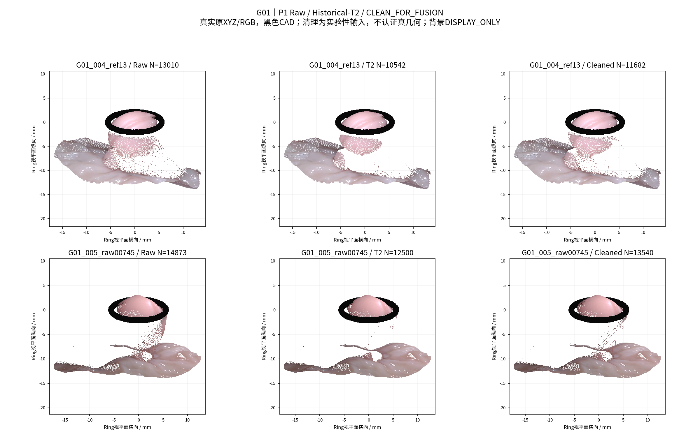
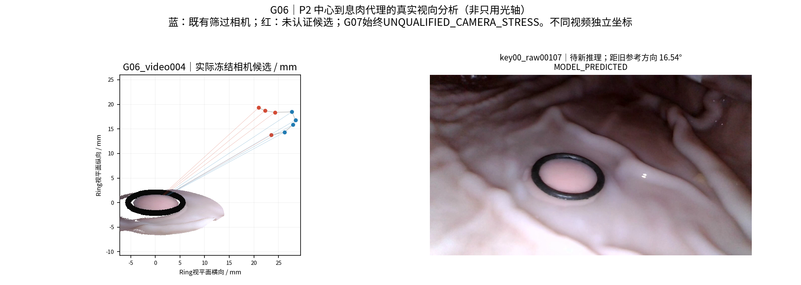
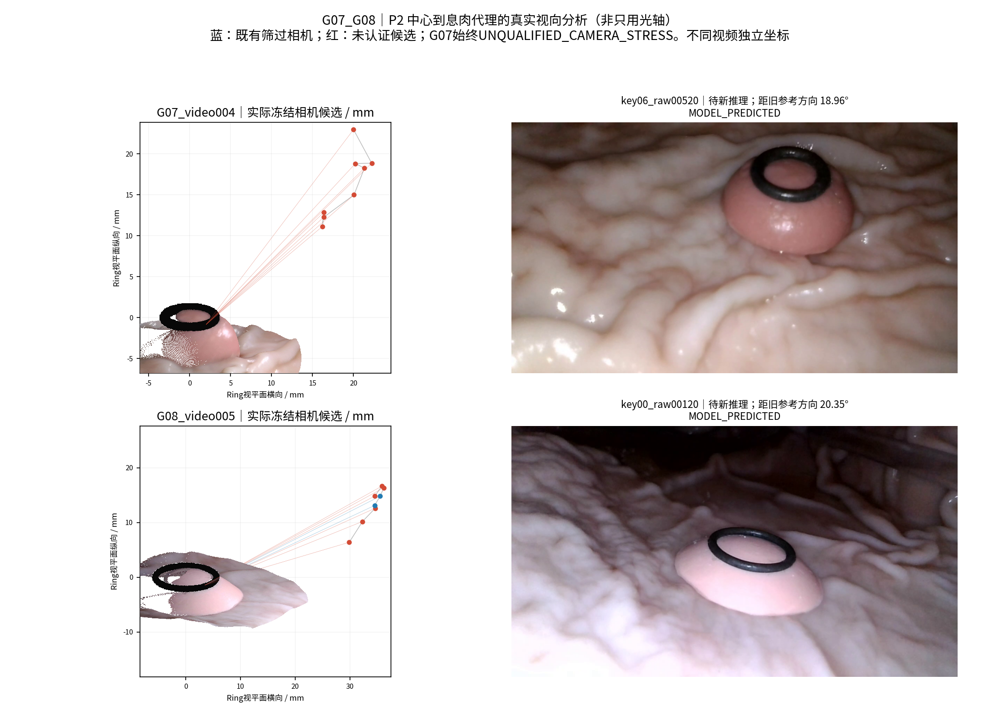
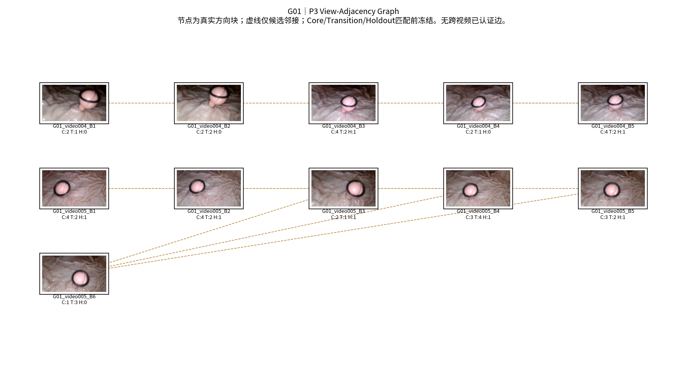

# 视角分区与MASt3R辅助选择性聚合

状态：RUNNING / EXPERIMENTAL。四批次连续授权；GT模式NONE。仅新增派生结果，旧P0/相机/HERO权重/Dxy冻结。物理精度尚未认证。

中文摘要：本轮按真实相机与息肉中心代理方向组织视角块，采用既有绝对密度T2与细小结构保护生成Cleaned，使用官方MASt3R匹配和Ring约束派生配准，再对新方向运行冻结HERO，最后进行方向负责制聚合。相机未筛选场景与照片保持候选身份，成功与失败均保留。报告在各批次以同一文件更新，不将数值输出、展示、融合验收和物理测量混为一谈。

## Batch A — Cleaned与方向分区

P0–P3已实算：4独立物理组、5视频、9归档P0；62个冻结视频相机候选与3张位姿未知照片；21个方向块。G07为UNQUALIFIED_CAMERA_STRESS。下表方向仅在各视频独立Ring局部坐标内成立，不等同位姿真值；候选坏位姿可能产生虚假的方向跨度。

|组|Raw点|Cleaned点|方向块|新HERO计划|
|---|---|---|---|---|
|G01|98843|92933|11|G01_video004_004_00, G01_video005_v005_00229|
|G06|9282|9256|3|G06_video004_key00_raw00107|
|G07|19784|19386|3|G07_video004_key06_raw00520|
|G08|19631|17381|4|G08_video005_key00_raw00120|

G01 T2为004=49.21594809052892、005=58.17189372286792点/mm²。其他组三组统一实验性迁移49.21594809052892，不按组调参。保护可能细柄代理、Ring邻近与原完整小分量；不移动XYZ、不补孔。Cleaned始终实验候选，损伤与孔洞统计完整保留，不采用上轮被拒绝的角度法。

方向用(c−息肉中心代理)/距离；中心由已清理源点上部60%源像素的中位XYZ确定，无GT。Complete-link 10°，邻接18°和冻结参考投影Mask支持≥35%。Core/Transition/Holdout身份已在正式匹配及图像误差评价前冻结；孤立块无独立留出时明确无验证。三照片没有公制位姿，不进入精确方向聚类。

预选5份新参考是与旧P0方向差最大的非留出真实帧，差约10.19°/12.50°/16.54°/18.96°/20.35°；这些方向差依赖冻结候选相机，**不证明新真实表面存在**。G01_005、G06/G08新目标仍含MODEL_PREDICTED相机，Batch B必须检查派生PnP；不把它们升级为已认证位姿。G07全部压力测试，仍实际尝试新增参考。

已核实本地官方MASt3R权重SHA与HERO原权重SHA，GPU6GB，磁盘约6GB余量；模型不复制、不下载、不训练。官方实现与许可依据：[MASt3R](https://github.com/naver/mast3r)、[许可](https://github.com/naver/mast3r/blob/main/LICENSE)；代码/权重只读，匹配点图不充作公制P0。

每个P0/P1/P2/P3阶段另有3张真实复合图，覆盖四组，见图库。下一批固定使用这些分区和帧身份进行MASt3R全图/ROI及历史对照，不按最终RGB误差选配对。
